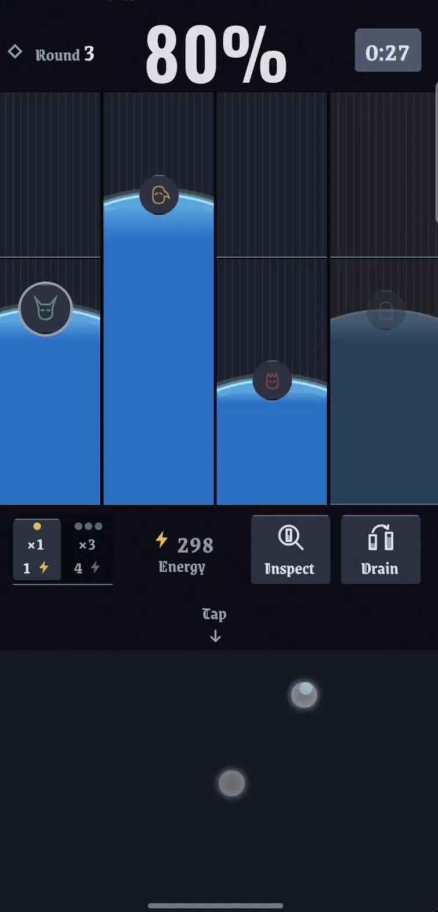
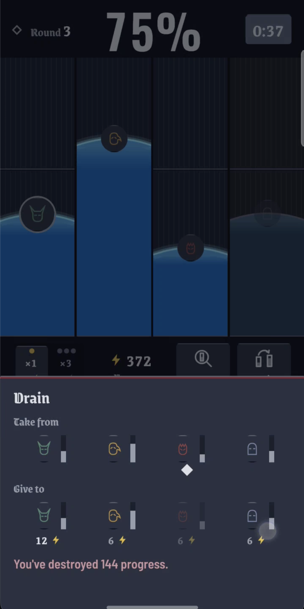
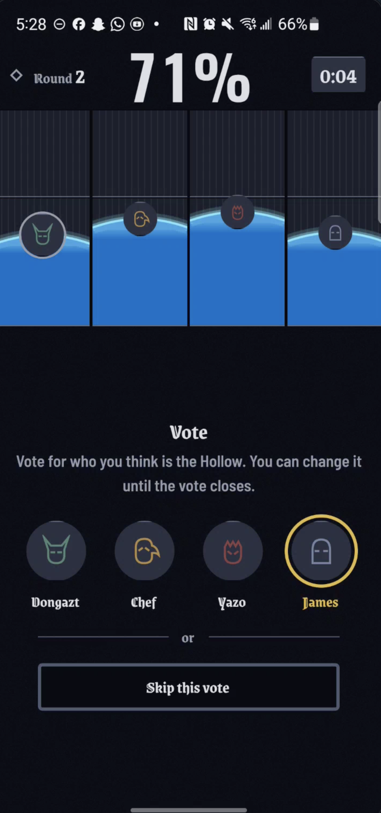
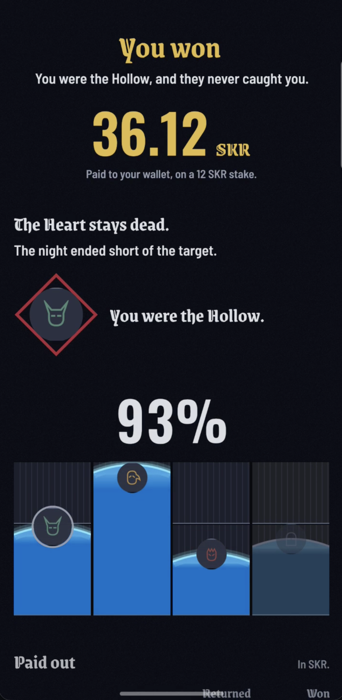
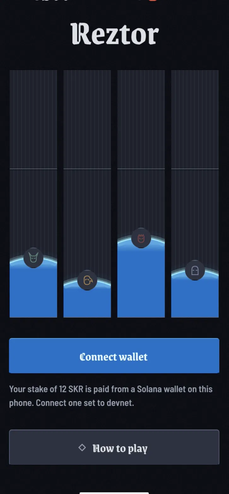
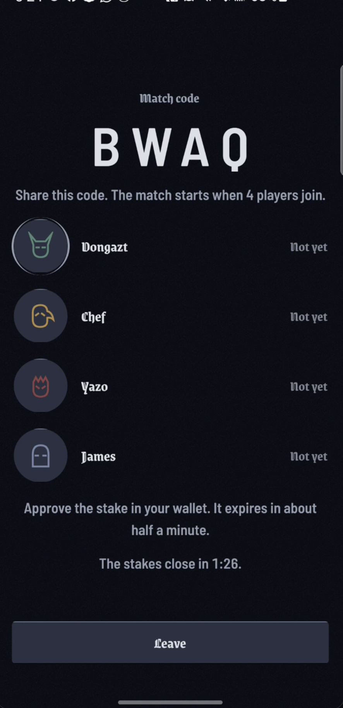
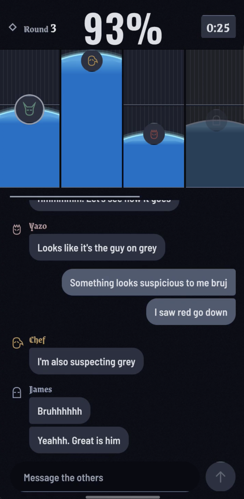
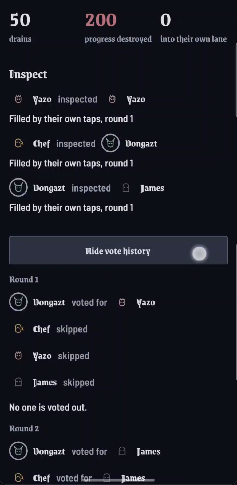

# Reztor

**A four-player social deduction game for Solana Mobile.** Each player stakes SKR, all four
fill a shared board together, and one of them is secretly draining it. Find the impostor
before the clock runs out.

- **Android APK:** [app-release.apk](https://github.com/Akshola00/reztor/releases/download/v1.0.0/app-release.apk)
- **Demo video:** https://youtu.be/1LIaa1_dLbM
- **Deck:** [Google Slides](https://docs.google.com/presentation/d/1boQLhbMiab7Gxs5tB40ngPLsfwM3ccBPOxYEeX7EKkc/edit?usp=sharing)
- **Program (devnet):** [`4hAFR3JFKmE5GkJFDSVUHB1LwcsZkQBszCq9kwFu5MHZ`](https://explorer.solana.com/address/4hAFR3JFKmE5GkJFDSVUHB1LwcsZkQBszCq9kwFu5MHZ?cluster=devnet)

<p>
  
  
  
  
</p>

## How a match works

1. **Connect and stake.** Connect a wallet through Mobile Wallet Adapter, then create a match
   or join one with a four-letter code. Each player signs one `join_match` transaction that
   moves 12 SKR into a program-owned escrow vault.
2. **Roles.** Three players are crew and one is the impostor. Only you can see your role.
3. **Tap.** 1 SKR buys 100 energy. Tapping spends energy to fill your own lane. The ×3 tier
   is faster but costs more per unit. Crew wins when the whole board reaches 60%.
4. **Drain.** The impostor can also pull progress out of one lane and give part of it to
   another, destroying the difference. The victim's lane drops and someone else's jumps,
   and neither of them is the impostor.
5. **Inspect, chat, vote.** Once per match, a player can inspect a lane to see what moved it
   in the last round: taps, a gift, or a drain. After each 60-second
   tap round there are 45 seconds of chat and 15 seconds of simultaneous voting. There are
   three rounds.
6. **Settle.** The server signs `settle_match`. Winners split the energy that was spent,
   and every player gets their unspent energy back as SKR. The result screen links to the
   transaction on Solana Explorer.

| Connect | Join | Drain | Chat | Vote | Result |
| :-: | :-: | :-: | :-: | :-: | :-: |
|  |  |  |  |  |  |

## On-chain

The escrow is an Anchor program. The game server is the match authority, but it never holds
player funds. Every SKR in a match sits in a vault owned by the match PDA.

| Instruction | Signed by | Does |
| :---- | :---- | :---- |
| `create_match` | server authority | Creates the match account and its token vault, and fixes the four seats |
| `join_match` | the player (MWA) | Moves the buy-in into the vault |
| `settle_match` | server authority | Pays winners their share of spent credits plus everyone's unspent credits; any rake goes to the treasury |
| `void_match` | server authority, **or any seated player after the timeout** | Refunds every joined player in full and closes the vault |

**Funds can't get stuck.** If the server disappears, any player who joined can call
`void_match` once `void_timeout_secs` has passed, and everyone is refunded. The server's
permission isn't needed. See
[`void_match.rs`](contract/programs/reztor/src/instructions/void_match.rs).

### Live devnet transactions

One full match, all on devnet with mock SKR:

- create: [isZRgnTm…](https://explorer.solana.com/tx/isZRgnTmXnUzWUSiKppxERttxKDFaRwnjdg2ssqQxE8XYTKWRg5btW9ttPRG2WpFtXDBHicwpPHrL3AJWYkqFy9?cluster=devnet)
- joins: [34pgqz4Q…](https://explorer.solana.com/tx/34pgqz4QMoqPARKofjSEQze8ZVRoXaGM31bkTbZFgdr6Tsn5ZnrA75EYUB2ie2nhbXFLxfT3JrnAbXBbuyvEDF27?cluster=devnet),
  [465jjLT2…](https://explorer.solana.com/tx/465jjLT2VHPdEPFHvfmvAjhxt83NeWNtKqwFPJkXEkxqG7sXnhmK3qqVrj9Yywh5Rv7ZhAxjysoZiBxyLnbdAxtW?cluster=devnet),
  [4KEuRTQZ…](https://explorer.solana.com/tx/4KEuRTQZQGJTZekap8L5qqRu18U2DbRo6MiFpZ8CBkKiJ75gzSvojB9yLxNYZXUZYQDh8UkHho1fYGj1arV431w5?cluster=devnet),
  [5NpjyDp3…](https://explorer.solana.com/tx/5NpjyDp3ksrWpVtVPc5keRxmtAMf8Q2jbfVBYVYbiKU8XiHcaK3GsQBcpGpKPsXgKUPtyx68uDUiyEArKMBBPzjj?cluster=devnet)
- settle: [4TQZTUJK…](https://explorer.solana.com/tx/4TQZTUJKtniYpFHtWQrdeBBxWwSa5rn53JexmTtepHsx7xMDxzrDZPPeRL6qrRnx11qw3k7BLYNWXQeSgVGTAhoF?cluster=devnet)

A lobby that never filled, refunded in full by `void_match`:
[2EsFqnQu…](https://explorer.solana.com/tx/2EsFqnQufSJTeWYjRbTR3Lvm4GePQTShsjvXMHTpFjhWmvdy69YEaaq1xW5f4QzbiqeNhbp1oqTLrVfBSuXfcHRy?cluster=devnet)

All addresses and the config are in [`contract/docs/DEVNET.md`](contract/docs/DEVNET.md).

### Audit notes

An automated scan (Radiants advisory module, commit `c7a4378`) reported 8 High findings. We
checked each one. None is a defect in the program or the app:

- **`void_match.rs:20`, "missing signer check on `authority`".** This is deliberate. That
  account only receives the rent back, and `address = config.authority` pins its address. The
  real signer is `caller: Signer`. The handler checks that the caller is either the authority,
  or a seated player who has joined and is past the timeout. Requiring the authority to sign
  would break the escape hatch above.
- **`utils.rs:30`, "type cosplay".** Before deserializing, the code checks that the account's
  owner is the instruction's token program (`info.owner == token_program`). It then checks that
  the token account's mint is the match mint and that its owner is the player in that seat.
  That is the correct way to validate a token account passed in `remaining_accounts`.
- **Dependency CVEs.** Most come from `contract/`'s JS test tooling: js-yaml, minimatch,
  nanoid, serialize-javascript and diff are all dependencies of mocha and ts-mocha. None of them
  is in the program or the app. The rest come in indirectly through the pinned Solana JS SDKs
  (`@solana/web3.js` 1.x, `@anchor-lang/core`, `@solana/spl-token`). These include toml,
  bigint-buffer (which has no published fix), stream-json and uuid. Exploiting them needs a
  malicious RPC or code paths we don't call. Dependencies stay pinned for the submission.
- The rest are Low/Info pattern matches that Anchor already enforces: owner checks on
  `Account<T>`, and CPI targets that come from `Interface<TokenInterface>`.

## Repository

Three independent packages. Each one installs and builds separately, with no workspace.

| Package | What | Stack |
| :---- | :---- | :---- |
| [`mobile/`](mobile/) | Android app | Expo, React Native, react-native-svg, Reanimated, @solana/kit, Mobile Wallet Adapter |
| [`server/`](server/) | Authoritative game server: rules, timers, roles, chain calls | Node, TypeScript, Socket.IO, Anchor client |
| [`contract/`](contract/) | Escrow program | Anchor (Rust) |
| [`docs/`](docs/) | Game spec, client/server protocol, chain protocol | |

## Run it

Every package uses **pnpm**. Run commands inside the package, never from the repo root.

**Mobile** (needs a development build; Expo Go can't load MWA's native modules):

```bash
cd mobile && pnpm install && pnpm run android
```

**Server:**

```bash
cd server && pnpm install
pnpm test        # rules engine, protocol, chain client, golden and property tests
pnpm run serve   # set ESCROW_MODE=chain plus RPC_URL, PROGRAM_ID and MINT for devnet
```

**Contract:**

```bash
cd contract && pnpm install
anchor build && anchor test
```

**Play alone with bots:** [`server/scripts/DEMO.md`](server/scripts/DEMO.md) seats three
bot players around one phone against the hosted server.

## Status

- Runs on Solana **devnet** with a mock SKR mint, not the real SKR token.
- The hosted server is on a free tier and sleeps when idle, so the first connection can take
  about a minute.
